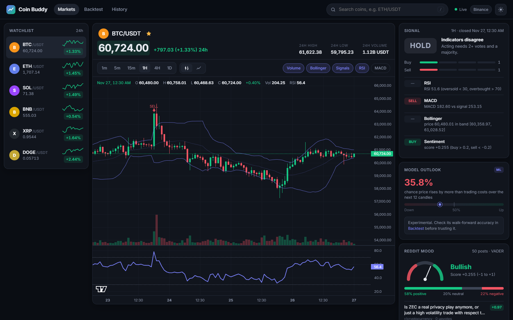
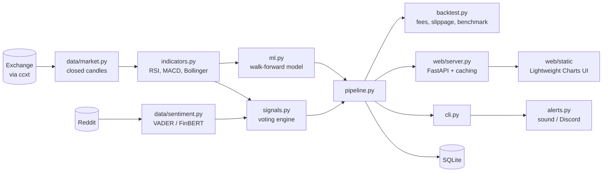
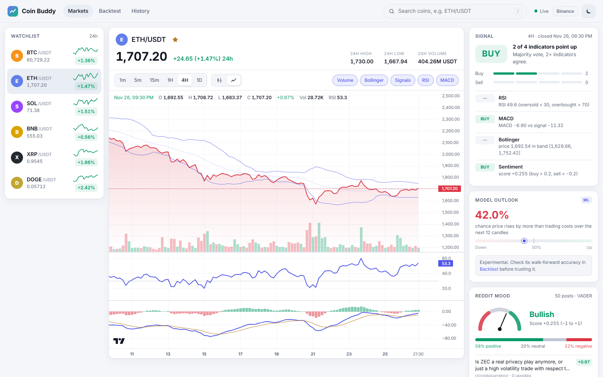
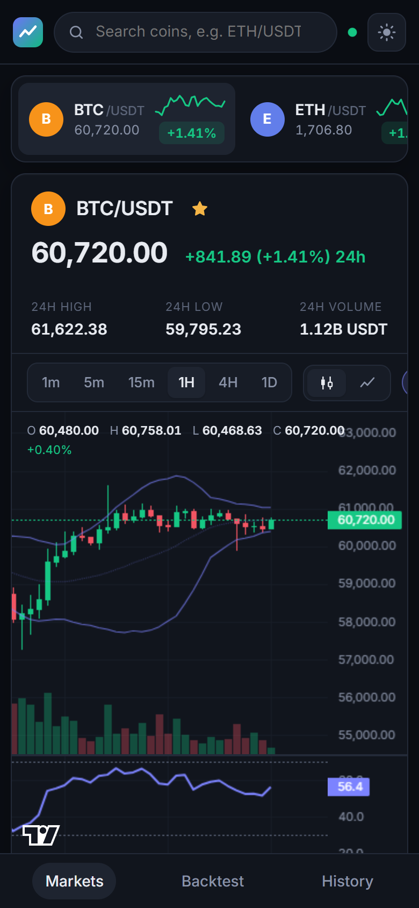
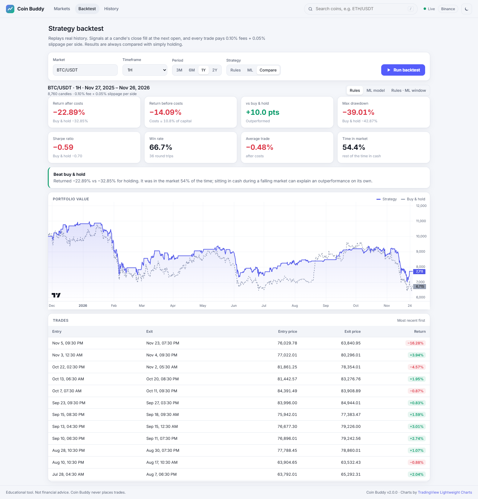
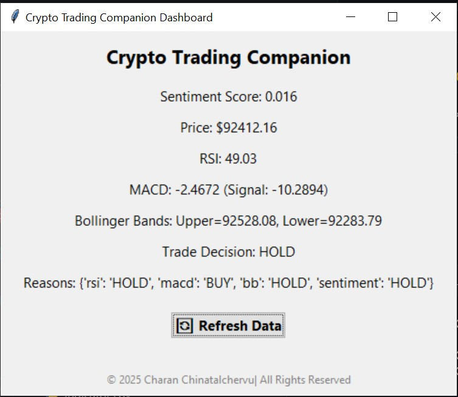
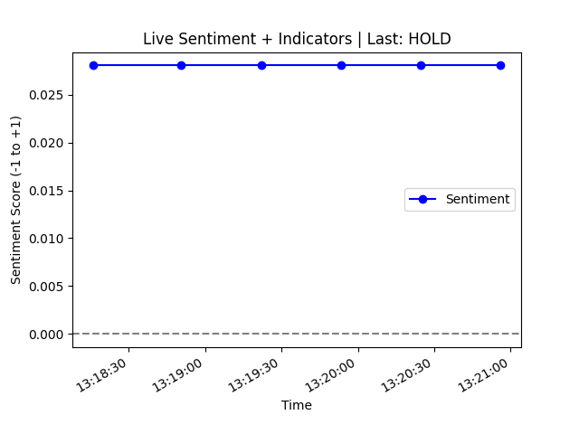

# 🪙 Coin Buddy

**Crypto market signals from technical indicators and Reddit sentiment, with an honest backtester that shows whether they actually work.**

Coin Buddy pulls live candles from any of 100+ exchanges, scores Reddit sentiment, combines the two in an explainable voting engine, and tests every strategy (rule-based and machine-learning) on real history with fees, slippage and no lookahead.

**No API keys and no paid services are needed. Every dependency is free and open-source.**

> ⚠️ Educational project. Not financial advice. Coin Buddy never places trades.
>
> © 2025–2026 **Charan Chintalachervu**. All rights reserved. See [LICENSE](LICENSE).



> 📖 **Documentation: <https://charanchintalachervu.github.io/CoinBuddy/>**
>
> A searchable docs website covering installation, every part of the dashboard, the maths behind each signal, the architecture, the API, a generated code reference, and how to extend it. It updates automatically on every push to `main`. To preview it locally: `pip install -e ".[docs]"`, then `mkdocs serve -a 127.0.0.1:8001`.

---

## Key finding

Backtested on 2 years of hourly BTC/USDT candles (Nov 2024 – Nov 2026), with 0.10% fee + 0.05% slippage per side:

| Strategy | Before costs | After costs | Buy & hold | Trades | Note |
|---|---|---|---|---|---|
| Rule engine (RSI + MACD + Bollinger) | −23.2% | **−37.0%** | −34.3% | 66 | No edge, and worse than holding |
| ML model (walk-forward, out-of-sample) | **+20.6%** | **−82.4%** | −37.1% | 640 | A real edge before costs, destroyed by over-trading |

**What this shows:** classic indicators, which everyone watches, carry no edge after costs. The ML model found real short-term patterns, but it switched position 640 times, and fees consumed far more than it earned. Its accuracy (58.0%) is also below a naive baseline that always predicts "no gain" (61.9%). Making that model trade less is the obvious next step; see [Ideas to extend](#ideas-to-extend).

Reproduce it with `coin-buddy backtest --days 730 --report`. Numbers will differ as new data arrives.

---

## Features

- **Live signal with full reasoning:** every BUY/SELL/HOLD shows each indicator's vote and why.
- **Any exchange, any coin:** public data via ccxt (Binance, Kraken, Coinbase, Bybit, OKX…).
- **Crypto-aware sentiment:** VADER plus a crypto slang lexicon ("moon", "rekt", "rugpull"…), with optional FinBERT.
- **Honest backtester:** next-candle execution, fees and slippage, buy-and-hold benchmark, drawdown, Sharpe ratio, time in market.
- **ML model trained on real outcomes:** walk-forward evaluation with a gap between training and test data to prevent leakage, scored against a naive baseline.
- **Trading-style web dashboard:** live prices that flash on change, a watchlist with sparklines, interactive candlestick/line charts (zoom, pan, crosshair readout) with volume, Bollinger Bands, RSI and MACD panes and BUY/SELL markers, signal, ML and sentiment cards, an interactive backtester, dark/light themes, and a mobile layout.
- **History in SQLite:** every snapshot and scored post is stored, building a sentiment history you can backtest later.
- **Alerts:** a sound on your machine, plus optional free Discord webhook messages.
- **Engineering:** typed config, 61 offline tests (including the web API), ruff linting, GitHub Actions CI, Docker, a strict Content-Security-Policy.

## Architecture



## Quick start

Requires **Python 3.10+**.

```bash
python -m venv .venv
.venv\Scripts\activate            # Windows
# source .venv/bin/activate       # macOS / Linux

pip install -e ".[dev]"           # app + test tools
coin-buddy snapshot               # current signal with explanation
coin-buddy dashboard --open       # web app at http://127.0.0.1:8000
```

That's it: no keys and no `.env` needed. To add optional extras, copy `.env.example` to `.env`.

> **In the US?** Binance blocks US IP addresses. Use `--exchange coinbase --symbol BTC/USD`, or set them in `config.yaml` (Coinbase also serves the full history backtests need; Kraken only serves about a month).

## Commands

| Command | What it does |
|---|---|
| `coin-buddy snapshot` | Prints the current signal, each vote with its reason, sentiment, and ML probability |
| `coin-buddy watch --interval 300` | Re-checks every 5 minutes, saves history to SQLite, alerts when the signal changes |
| `coin-buddy backtest --days 365 --report` | Rules vs ML vs buy-and-hold on real history, plus an interactive HTML report in `reports/` |
| `coin-buddy train --days 730` | Trains the ML model on real history and saves it to `models/` (the dashboard and snapshot then show P(up)) |
| `coin-buddy dashboard --open` | Starts the web app (`--host`, `--port` optional) and opens it in your browser |

Every market command accepts `--exchange`, `--symbol` and `--timeframe`, for example:

```bash
coin-buddy backtest --symbol ETH/USDT --timeframe 4h --days 1000 --strategy rules
```

`python -m coin_buddy <command>` works too.

## Configuration

Everything tunable lives in [config.yaml](config.yaml): exchange, symbol, timeframe, indicator windows, vote thresholds, subreddits, sentiment model, fees, slippage and ML settings. Unknown keys raise an error, so typos never fail silently.

Optional secrets go in `.env` (see [.env.example](.env.example)):

| Variable | Purpose |
|---|---|
| `REDDIT_CLIENT_ID`, `REDDIT_CLIENT_SECRET`, `REDDIT_USER_AGENT` | Use the official Reddit API (higher rate limits) instead of the public JSON feed. Needs `pip install -e ".[reddit]"` |
| `DISCORD_WEBHOOK_URL` | Send BUY/SELL alerts to a Discord channel |

### Stronger sentiment model (optional)

```bash
pip install -e ".[finbert]"      # ~1.5 GB (PyTorch); runs on CPU
```

Then set `sentiment.model: finbert` in `config.yaml`.

## The web app

| Markets (light theme) | Mobile |
|---|---|
|  |  |



- **Markets:** a watchlist with 24h sparklines (star any market to add it; your list is saved in the browser), live prices polled every 10 s, a full chart with crosshair OHLC readout, toggles for indicators and chart type, and cards explaining the signal, ML outlook and Reddit mood with links to the scored posts.
- **Backtest:** pick a market, period and strategy, then compare rules, ML and buy-and-hold with KPIs, an automatically written takeaway, the equity curve and every trade.
- **History:** every signal the app computes, saved in SQLite.
- **Small details:** `/` focuses search, the URL keeps the symbol and timeframe (so links are shareable), polling pauses in background tabs, live chart updates keep your zoom position, and errors show retry buttons instead of blank screens.

Under the hood, a FastAPI server ([coin_buddy/web/server.py](coin_buddy/web/server.py)) exposes a JSON API. Interactive docs are at `/api/docs`. The API caches exchange calls so many open tabs don't multiply requests, and it sends security headers, including a strict Content-Security-Policy. The frontend is plain HTML, CSS and JavaScript in [coin_buddy/web/static/](coin_buddy/web/static/), with no Node.js or build step.

## How the signal works

Each indicator casts a vote: **+1 BUY**, **−1 SELL** or **0 abstain**.

| Indicator | BUY vote | SELL vote |
|---|---|---|
| RSI (14) | RSI < 30 (oversold) | RSI > 70 (overbought) |
| MACD (12/26/9) | MACD above signal line | MACD below signal line |
| Bollinger Bands (20, 2σ) | price ≤ lower band | price ≥ upper band |
| Reddit sentiment | average score > +0.2 | average score < −0.2 |

A side wins only with **at least 2 votes and a strict majority**; anything else is HOLD. If Reddit is unreachable, sentiment abstains instead of crashing the app. Every threshold is configurable.

## Tech stack (all free and open-source)

| Purpose | Tool | License |
|---|---|---|
| Exchange data | [ccxt](https://github.com/ccxt/ccxt) | MIT |
| Data processing | [pandas](https://pandas.pydata.org/), [NumPy](https://numpy.org/) | BSD |
| Machine learning | [scikit-learn](https://scikit-learn.org/) | BSD |
| Sentiment | [VADER](https://github.com/cjhutto/vaderSentiment), optional [FinBERT](https://huggingface.co/ProsusAI/finbert) | MIT / Apache 2.0 |
| Web API | [FastAPI](https://fastapi.tiangolo.com/), [Uvicorn](https://www.uvicorn.org/) | MIT / BSD |
| Interactive charts | [TradingView Lightweight Charts](https://github.com/tradingview/lightweight-charts) | Apache 2.0 |
| HTML backtest reports | [Plotly](https://plotly.com/python/) | MIT |
| Font | [Inter](https://rsms.me/inter/) via Google Fonts | OFL |
| Storage | SQLite (Python standard library) | Public domain |
| Testing and linting | [pytest](https://pytest.org/), [ruff](https://docs.astral.sh/ruff/) | MIT |

## Testing

```bash
pytest                    # 61 tests, fully offline: fake exchange, synthetic prices
ruff check . && ruff format --check .
```

Highlights of what's tested:
- Indicator math matches the reference `ta` library.
- The live (single-row) and backtest (vectorized) signal paths always agree.
- **No lookahead:** signals fill at the next open; changing a future candle never changes a past feature; walk-forward never trains on test data.
- Costs are charged correctly per side; candle pagination and dropping the still-forming candle work.
- Every web API endpoint: security headers, spot-only market lists, markers only on closed candles, signals saved to history, validation errors, and no `NaN` in JSON.

CI runs everything on Python 3.10 and 3.12 for every push ([.github/workflows/ci.yml](.github/workflows/ci.yml)).

## Deploy for free

**Docker**

```bash
docker build -t coin-buddy .
docker run -p 8000:8000 coin-buddy      # then open http://localhost:8000
```

**Free hosting on Render:** the repo includes a Render Blueprint (`render.yaml`). Sign in to [Render](https://render.com) with GitHub, choose **New → Blueprint**, and pick this repo; it deploys the Docker image on the free plan and redeploys on every push. Free hosts mostly run in the US, where Binance is blocked, so the image uses `config.hosted.yaml` (Coinbase with USD pairs). Full guide: the Deployment page in the docs.

## Project structure

```
coin_buddy/
├── config.py           # typed config from config.yaml + .env
├── data/
│   ├── market.py       # ccxt candles: pagination, retries, closed candles only
│   └── sentiment.py    # Reddit sources + VADER/FinBERT scoring
├── indicators.py       # RSI, MACD, Bollinger in pandas
├── signals.py          # voting engine (single-row + vectorized)
├── backtest.py         # costs, no-lookahead engine, metrics
├── ml.py               # features, labels, walk-forward, train/predict
├── pipeline.py         # wires everything for CLI + dashboard
├── storage.py          # SQLite history
├── alerts.py           # sound + Discord
├── charts.py           # Plotly figures for HTML backtest reports
├── cli.py              # coin-buddy command
└── web/
    ├── server.py       # FastAPI JSON API, caching, security headers
    └── static/         # index.html, styles.css, app.js (no build step)
tests/                  # 61 offline tests
docs/                   # documentation website (MkDocs Material)
mkdocs.yml              # docs site configuration

archive/v1/             # the original version, for comparison
```

## Ideas to extend

1. **Make the ML model trade less:** raise `ml.probability_threshold`, lengthen `ml.horizon_candles`, or add a minimum holding period. Re-run the walk-forward backtest each time.
2. **Backtest sentiment:** run `coin-buddy watch` for a few weeks, then pass `Store.sentiment_history()` into `signals.vote_frame()`.
3. **Add data that's harder to find:** funding rates and open interest (also via ccxt), or Fear & Greed index history.
4. **Position sizing:** scale exposure by volatility instead of all-in / all-out.
5. **Paper trading:** ccxt supports exchange testnets for simulated orders.

## Version history

- **v2.0:** full rebuild: ccxt, no keys, honest backtester, real-data ML, trading-style web app (FastAPI + Lightweight Charts), SQLite, tests, CI, Docker. Design reasoning is in [docs/DESIGN.md](docs/DESIGN.md).
- **v1.0:** Tkinter dashboard and matplotlib live chart, Binance + Reddit + TextBlob. Preserved in [archive/v1/](archive/v1/).

| v1 dashboard | v1 live chart |
|---|---|
|  |  |

## Author & copyright

**Coin Buddy is an original project created and designed by Charan Chintalachervu.**

© 2025–2026 Charan Chintalachervu. All rights reserved. No part of this project may be copied, modified, distributed or sold without written permission. See [LICENSE](LICENSE).

The earlier version in `archive/v1/` (v1.0) was published under the MIT License and remains available under it; see `archive/v1/LICENSE`.
