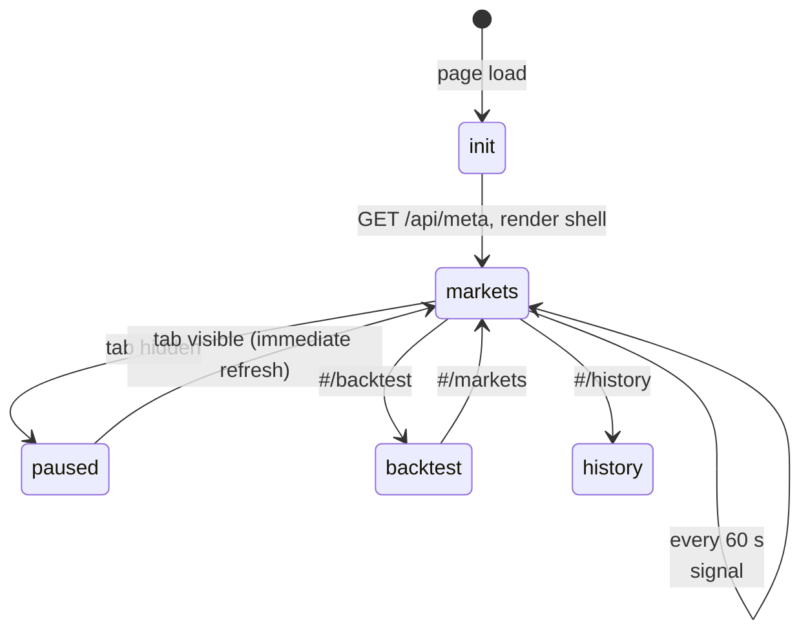

# Frontend

The browser app lives in `coin_buddy/web/static/` and is plain HTML, CSS and JavaScript. There's no framework, no Node.js and no build step: edit a file, reload the page.

| File | Role |
|---|---|
| `index.html` | Page structure: top bar, the three views (Markets, Backtest, History), footer, toast area. |
| `styles.css` | Design tokens (colours, radii), layout, components, responsive rules, both themes. |
| `app.js` | All behaviour: API calls, state, polling, the charts, rendering, routing. |
| `theme-init.js` | Applies the saved theme **before** the page paints, so it never flashes the wrong theme. |
| `favicon.svg` | Logo. |

The only external script is **TradingView Lightweight Charts 5.2.1**, loaded from jsDelivr with a [Subresource Integrity](https://developer.mozilla.org/docs/Web/Security/Subresource_Integrity) hash, so the browser refuses a tampered copy.

## How `app.js` is organised

The file is one self-contained module (an IIFE) in clearly marked sections:

| Section | What's in it |
|---|---|
| utilities | `$`/`$$` selectors, `esc()` HTML escaping, number/date formatters, `saved` (safe localStorage) |
| API + toasts | `api()`: fetch with timeout and friendly errors; `toast()` with de-duplication |
| state | The single `state` object: current market, timeframe, view, toggles, tickers, watchlist |
| live status | `markOk()` / `updateStatus()`: the Live, Delayed, Offline or Paused pill |
| watchlist | Render rows, sparklines, star/unstar |
| quote header | Price, flash animation, 24h stats |
| price chart | `buildChart()`, `seriesPayload()`, `loadChart()`, legend, markers |
| insight cards | `renderSignal()`, `renderML()`, `renderSentiment()` (with the SVG gauge) |
| selection | `selectSymbol()`, `selectTimeframe()`, search resolution, URL syncing |
| polling | `schedule()` / `tick()` |
| backtest | Form handling, `renderBacktest()`, KPI tiles, equity chart, trades table |
| history | `loadHistory()` |
| routing / theme / wiring | Hash router, theme toggle, all event listeners, `init()` |

## Data flow and refresh cycle

- **Polling, not WebSockets.** Every 10 seconds is plenty for 1-minute and longer candles, works through any proxy, and keeps the server stateless.
- **Pause when hidden.** `visibilitychange` stops polling in background tabs.
- **Stale-response guard.** Each loader remembers which symbol and timeframe it asked for and ignores the answer if you've switched since. A slow response for BTC can never overwrite ETH.

## The chart

`buildChart()` creates a Lightweight Charts instance and adds series according to the toggles:

| Pane | Series |
|---|---|
| 0 (price) | Candlestick **or** Area · Volume histogram (own hidden scale, bottom 18%) · 3 Bollinger lines · BUY/SELL markers plugin |
| 1 | RSI line with dashed 70/30 price lines (if enabled) |
| 2 | MACD histogram, MACD line, signal line (if enabled) |

Panes are sized with `setStretchFactor` (price 3.4 : others 1).

**Incremental updates.** On each poll, `loadChart({rebuild: false})` finds candles at or after the last one drawn and calls `series.update()` for each. That updates the forming candle or appends a new one **without resetting zoom or scroll**. A full rebuild happens only when the market, timeframe or toggles change, or after a long gap (more than 3 new candles, e.g. waking from sleep).

**Local time.** Lightweight Charts displays timestamps as UTC, so `toLocal()` shifts each timestamp by the browser's UTC offset before drawing.

**Price format.** `decimalsFor(price)` picks 2 decimals above 10, and up to 6 for tiny prices like DOGE. A custom formatter adds thousands separators.

## Theming

Every colour is a CSS custom property defined twice, under `:root[data-theme="dark"]` and `:root[data-theme="light"]`:

| Token | Used for |
|---|---|
| `--bg`, `--surface`, `--surface-2`, `--surface-3` | Page, cards, inputs, hover states |
| `--border`, `--grid` | Card borders, chart grid |
| `--text`, `--muted`, `--faint` | Text hierarchy |
| `--accent`, `--accent-soft` | Brand indigo, selected states |
| `--up`, `--down` (+ `-soft`) | Gains/losses, BUY/SELL |
| `--hold`, `--warn` | HOLD, warnings |

The canvas-based chart can't read CSS directly, so `colors()` reads the tokens with `getComputedStyle` and the chart is rebuilt when the theme changes.

## Security rules the frontend follows

The server's Content-Security-Policy forbids inline scripts and inline `style` attributes. So in the frontend code:

- **No `onclick=` handlers.** All events are attached with `addEventListener`.
- **No `style="…"` in HTML strings.** Dynamic values are set via the CSSOM, for example `el.style.setProperty("--w", "42%")`, which CSP allows. SVG colours come from CSS classes.
- **Every piece of external text is escaped** with `esc()` before it's inserted into HTML. Reddit titles are user-generated and could contain `<script>`.
- **Links are validated.** Reddit post links are only rendered when they start with `https://www.reddit.com/`.

## Accessibility

- Toggle buttons use `aria-pressed`, the current watchlist row and nav link use `aria-current`, and dynamic cards are `aria-live` regions.
- Everything works with the keyboard, with a visible focus ring. ++slash++ focuses search.
- Colour is never the only signal: BUY/SELL/HOLD are also written out, and changes carry a + or − sign.
- `prefers-reduced-motion` turns off animations.

## Responsive breakpoints

| Width | Layout |
|---|---|
| > 1360 px | Watchlist 264 px · chart · insights 344 px |
| 1120–1360 px | Narrower side columns |
| 760–1120 px | Single column; the watchlist becomes a horizontal strip; insight cards in a grid |
| < 760 px | Phone: bottom navigation bar, compact legend, scrollable toolbar |

## Adding a new insight card

1. Add an `<article class="card">` with a `card-head` and a body `div` inside `.insights` in `index.html`.
2. If it needs new data, add a field to the `/api/signal` response in `server.py` (and a test in `tests/test_web.py`).
3. Write a `renderX(s)` function in `app.js` and call it from `loadSignal()`.
4. Add a skeleton for it in `insightSkeletons()`.
5. Style it with existing tokens in `styles.css`, so both themes work automatically.
