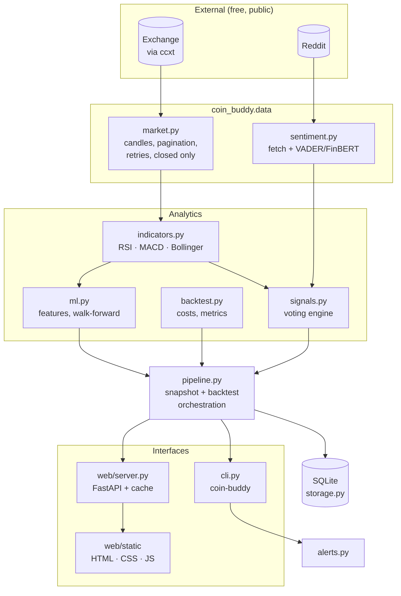
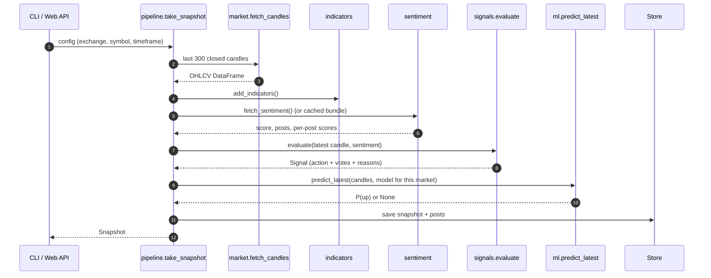
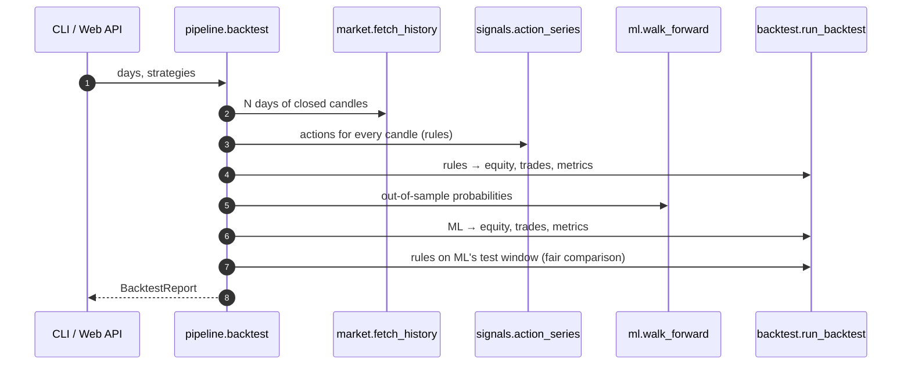
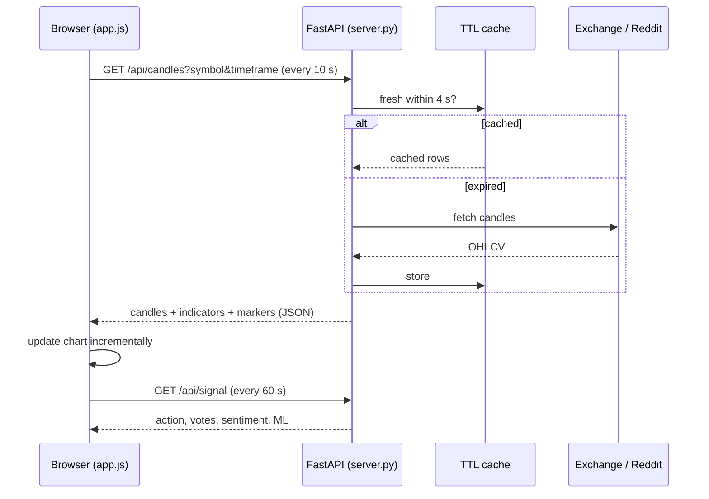

# Architecture overview

Coin Buddy is one Python package (`coin_buddy`) with three ways in: the **CLI**, the **web API**, and **tests**. All three call the same functions, so behaviour is identical everywhere.

## Components

## Modules at a glance

| Module | Responsibility | Depends on |
|---|---|---|
| `config.py` | Typed settings from `config.yaml` and `.env`; per-market model paths | PyYAML, python-dotenv |
| `data/market.py` | Fetch OHLCV candles from any exchange, page past request limits, retry network errors, drop the forming candle | ccxt |
| `data/sentiment.py` | Fetch Reddit posts, score them, aggregate | requests, VADER, optional praw/FinBERT |
| `indicators.py` | RSI, MACD, Bollinger, %B | pandas |
| `signals.py` | Votes → BUY/SELL/HOLD (single-row and vectorised) | NumPy, pandas |
| `backtest.py` | Simulate a target position with costs; compute metrics | pandas |
| `ml.py` | Features, labels, walk-forward evaluation, train/save/predict | scikit-learn, joblib |
| `pipeline.py` | `take_snapshot()` and `backtest()`: the two workflows everything uses | all of the above |
| `storage.py` | SQLite history of signals and posts | sqlite3 (standard library) |
| `alerts.py` | Sound and Discord notifications | requests |
| `charts.py` | Plotly figures for the HTML backtest report | Plotly |
| `cli.py` | The `coin-buddy` command | pipeline |
| `web/server.py` | JSON API, caching, security headers, static files | FastAPI, uvicorn |
| `web/static/` | The browser app | Lightweight Charts (CDN) |

## Workflow 1: a live signal

What happens when you run `coin-buddy snapshot` or open the dashboard's Signal card:

## Workflow 2: a backtest

## Workflow 3: the dashboard

The browser never computes signals. It asks the API and draws the answers:

Details: [Web API](web-api.md) · [Frontend](frontend.md).

## Design principles

1. **One source of truth.** Signals, backtests and the UI all run the same functions. A test proves the vectorised and single-row signal paths agree.
2. **No lookahead, anywhere.** Closed candles for signals; next-open fills in backtests; walk-forward with a gap for ML.
3. **Degrade, don't crash.** A Reddit outage makes sentiment abstain; a slow exchange shows "Delayed"; an alert failure logs a warning.
4. **Free and keyless.** Public endpoints only; secrets are optional and live in `.env`.
5. **Explainable.** Every number on screen can be traced to a formula in these docs.

The reasoning behind each choice is in [Design decisions](../DESIGN.md).
