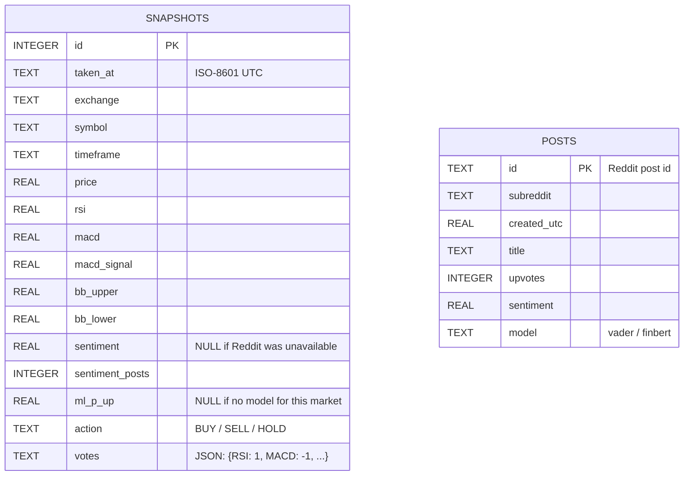

# Data & storage

Coin Buddy keeps everything it generates inside the project folder. None of it is committed to git.

| Path | What | Created by | In git? |
|---|---|---|---|
| `data/coin_buddy.db` | SQLite: every signal and every scored Reddit post | `snapshot`, `watch`, the dashboard | No |
| `models/<exchange>-<symbol>-<timeframe>.joblib` | Trained ML models | `coin-buddy train` | No |
| `reports/backtest.html` | Interactive backtest report | `coin-buddy backtest --report` | No |
| `.env` | Optional secrets | You | **Never** |

All four are in `.gitignore`.

## Why SQLite

It's built into Python, it's a single file with no server to run, and it supports real queries and de-duplication. That's everything a local history needs. See [Design decisions](../DESIGN.md#7-storage-sqlite).

## Schema



Indexes: `snapshots(taken_at)` and `posts(created_utc)`.

- **`snapshots`** gets one row per computed signal.
- **`posts`** gets one row per Reddit post. The Reddit id is the primary key and inserts use `INSERT OR IGNORE`, so a post fetched by many snapshots is stored once.

## Reading the data

=== "Python"

    ```python
    from coin_buddy.config import load_config
    from coin_buddy.storage import Store

    cfg = load_config()
    store = Store(cfg.resolve(cfg.storage.database))

    signals = store.snapshots(limit=1000)  # pandas DataFrame, oldest → newest
    hourly = store.sentiment_history("1h")  # Series: mean post sentiment per hour
    print(signals.groupby("action").size())
    ```

=== "SQL"

    ```bash
    sqlite3 data/coin_buddy.db
    ```

    ```sql
    -- How often each signal occurred, per market
    SELECT symbol, timeframe, action, COUNT(*) AS n
    FROM snapshots GROUP BY 1, 2, 3 ORDER BY 1, 2, 3;

    -- Most negative posts in the last day
    SELECT datetime(created_utc, 'unixepoch') AS at, subreddit, sentiment, title
    FROM posts
    WHERE created_utc > strftime('%s', 'now') - 86400
    ORDER BY sentiment LIMIT 10;
    ```

## Model files

Each `.joblib` file is a dictionary:

| Key | Content |
|---|---|
| `model` | The fitted `HistGradientBoostingClassifier` |
| `features` | Feature names, in order |
| `horizon` | Prediction horizon in candles |
| `exchange`, `symbol`, `timeframe` | The market it was trained on. Predictions for any other market are refused. |
| `trained_until` | Timestamp of the last training candle |

!!! warning "Only load model files you trust"
    `.joblib` files are pickles, and loading one can run arbitrary code. Only load models you trained yourself.

## Resetting

Delete `data/` to clear history, `models/` to remove models, and `reports/` to remove reports. Coin Buddy recreates the folders when needed.
