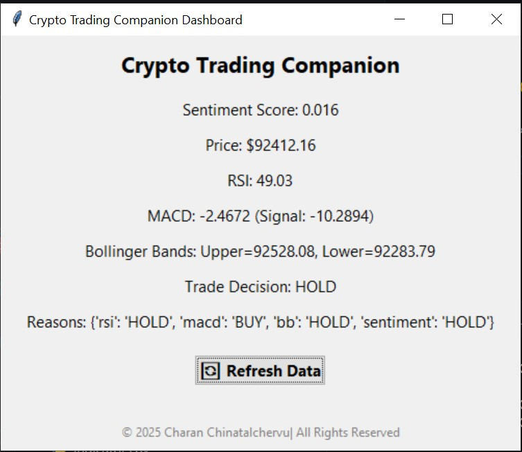
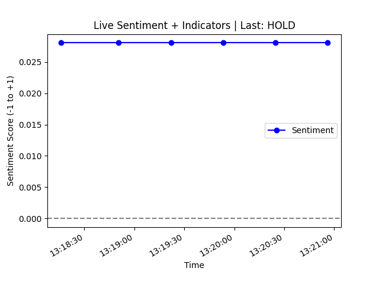

# Changelog

## 2.0.0 (November 2026)

A complete rebuild of v1.

**New**

- Trading-style web app (FastAPI + TradingView Lightweight Charts): watchlist with sparklines, live prices, interactive charts with volume, Bollinger, RSI and MACD panes and signal markers; signal, ML and sentiment cards; a Backtest page; a History page; dark/light themes; mobile layout.
- Honest backtester: next-open execution, fees and slippage, buy-and-hold benchmark, drawdown, Sharpe ratio, time in market, trade list, HTML reports.
- ML model trained on real outcomes with walk-forward evaluation, a purged gap and a naive baseline; one model per market.
- Market data for 100+ exchanges via ccxt, **with no API keys**.
- VADER sentiment with a crypto lexicon, optional FinBERT, and a keyless Reddit source.
- SQLite history of signals and scored posts.
- `coin-buddy` CLI: `snapshot`, `watch`, `backtest`, `train`, `dashboard`.
- Discord webhook alerts.
- Typed config with strict keys; 55 offline tests; ruff; GitHub Actions CI; Docker; this documentation site.

**Fixed (compared with v1)**

- A BUY/SELL tie always returned BUY because of dictionary ordering; ties are now HOLD.
- The "AI" model was trained on random numbers labelled by the rules; it now learns from real price outcomes.
- API keys were hard-coded in source; keys are no longer needed at all.
- Indicators were computed on the still-forming candle; signals now use closed candles only.
- Sentiment used only titles, scored by TextBlob (which scores most headlines 0); it now uses title and body, scored by VADER with crypto slang.

## 1.0.0 (2025)

The original version: a Tkinter dashboard, a matplotlib live chart, Binance prices via python-binance, Reddit titles scored with TextBlob, and a RandomForest trained on synthetic data. It's preserved in `archive/v1/` for comparison.

| v1 dashboard | v1 live chart |
|---|---|
|  |  |
