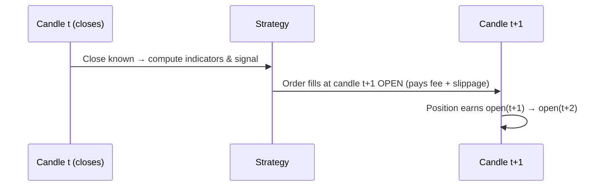

# Backtesting

A backtest replays history to ask: *if I had followed this strategy, what would have happened?* Most backtests online are flattering because they skip costs or quietly use future data. Coin Buddy's backtester (`coin_buddy/backtest.py`) is built to avoid both.

## The rules

| Rule | Why it matters |
|---|---|
| **No lookahead.** A signal computed from candle \(t\)'s close fills at candle \(t+1\)'s **open**. | You only know a candle's close once it has happened. Filling at that same close (the most common backtest bug) uses information you didn't have. |
| **Every position change pays costs**: fee + slippage, per side. | Short-timeframe strategies often have an edge before costs and lose money after. |
| **Always compare with buy-and-hold** over the identical period. | "−30%" might be excellent in a market that fell 40%. |
| **Report time in market.** | A long-only strategy sitting in cash during a crash beats holding without any skill. |
| **Spot, long-only.** | Positions are either 100% in the coin or 100% in cash. No leverage and no shorting, matching what most people can actually do. |

## Timing, step by step

## The maths

Let \(O_t\) be the open of candle \(t\), and \(\text{target}_t \in \{0, 1\}\) the position the strategy wants after candle \(t\) closes.

**Per-candle return of the asset** (open to open):

\[
r_t = \frac{O_{t+1}}{O_t} - 1
\]

**Position held during candle \(t\)** is the previous candle's decision:

\[
h_t = \text{target}_{t-1}
\]

**Turnover** (how much of the portfolio was traded at this open):

\[
\tau_t = |h_t - h_{t-1}|
\]

**Strategy return per candle**, with \(c\) = fee + slippage per side (0.15% by default). Costs come off the capital first, then the candle's return applies:

\[
R_t = (1 - \tau_t\, c)\,(1 + h_t\, r_t) - 1
\]

**Equity** starting from capital \(K\) (10,000 by default):

\[
E_T = K \prod_{t \le T} (1 + R_t)
\]

**One round trip** (buy at \(O_{in}\), sell at \(O_{out}\)) after costs:

\[
\text{net} = \frac{O_{out}}{O_{in}}\,(1 - c)^2 - 1
\]

So with the defaults a round trip costs about **0.3%**. A strategy's average trade must comfortably beat that.

## Metrics

| Metric | Definition |
|---|---|
| **Return after costs** | \(\prod (1 + R_t) - 1\) |
| **Return before costs** | The same with \(c = 0\): \(\prod (1 + h_t r_t) - 1\) |
| **Buy & hold** | \(\prod (1 + r_t) - 1\), holding from the first open to the last |
| **Sharpe ratio** | \(\dfrac{\overline{R}}{\sigma_R}\sqrt{N}\), with \(N\) = candles per year (8,760 for 1h). No risk-free rate is subtracted. |
| **Max drawdown** | \(\min_t \left(\dfrac{E_t}{\max_{s \le t} E_s} - 1\right)\): the worst peak-to-trough fall |
| **Time in market** | Mean of \(h_t\): the share of candles holding the coin |
| **Round trips** | Number of entries (an open position at the end is closed at the last open) |
| **Win rate** | Share of round trips with net > 0 |
| **Average trade** | Mean net return per round trip |
| **Costs paid** | \(c \sum_t \tau_t\): a simple sum, as a fraction of starting capital (ignores compounding) |

## Which strategies are tested

| Name | Target position |
|---|---|
| `rules` | From the [signal engine](signals.md): BUY → 1, SELL → 0, HOLD → keep. Sentiment isn't included, because free historical Reddit data doesn't exist (see [History](../user-guide/history.md)). |
| `ml` | From the [ML model](machine-learning.md)'s out-of-sample probabilities: ≥ 0.55 → 1, < 0.45 → 0, otherwise keep. |
| `rules (ML test window)` | The rules again, restricted to the period ML was tested on, for a fair comparison. |

## What a backtest can't tell you

- **The future.** One period, one market, one set of costs. Results change with new data.
- **Real fills.** Slippage is a fixed estimate; large orders or illiquid coins cost more.
- **Overfitting.** If you tweak thresholds until the backtest looks good on the same data, the result is meaningless. Change settings, then check them on a **different** period or market.

These caveats are why the [key finding](../index.md#the-key-finding) is framed as "no edge after costs" rather than "this strategy works".
