# Machine learning

Coin Buddy includes a machine-learning model (`coin_buddy/ml.py`) as a contrast to the rule-based votes. It's built to be **honest** rather than impressive: trained on real outcomes, tested only on data it never saw, and compared with a naive baseline.

## The question the model answers

> *If I buy at the next candle's open and sell \(h\) candles later, will I beat the round-trip trading cost?*

That's a yes/no (**classification**) question. With the defaults, \(h = 12\) candles and the round-trip cost is \(2 \times 0.15\% = 0.3\%\).

**Label** for candle \(t\):

\[
y_t = \begin{cases} 1 & \text{if } \dfrac{O_{t+1+h}}{O_{t+1}} - 1 > 2c \\[4pt] 0 & \text{otherwise} \end{cases}
\]

The last \(h + 1\) candles have no label, because their future hasn't happened yet.

## Features

All features are known at candle \(t\)'s close and are **scale-free**: they don't depend on whether BTC is at $30k or $90k, so a model trained at one price level still works at another.

| Feature | Definition |
|---|---|
| `rsi` | RSI (0–100) |
| `macd_hist_pct` | MACD histogram ÷ close |
| `bb_pct_b` | Bollinger %B |
| `ret_1`, `ret_3`, `ret_12`, `ret_24` | Return over the last 1, 3, 12 and 24 candles |
| `volatility_24` | Standard deviation of 1-candle returns over 24 candles |
| `volume_z` | Volume's z-score against its last 48 candles |

Sentiment isn't a feature yet, because free historical Reddit data doesn't exist. Once `coin-buddy watch` has built a history, it can be added.

## The model

scikit-learn's `HistGradientBoostingClassifier`: an ensemble of shallow decision trees, each correcting the previous ones.

| Setting | Value | Why |
|---|---|---|
| `max_depth` | 3 | Shallow trees overfit less. |
| `learning_rate` | 0.05 | Small steps, more stable. |
| `max_iter` | 200 | Number of trees. |
| `l2_regularization` | 1.0 | Penalises extreme leaf values. |
| `random_state` | 42 | Reproducible results. |

## Walk-forward evaluation

Testing a time-series model on a **random** split leaks the future into training: the model learns from Tuesday and is "tested" on Monday. Coin Buddy uses **walk-forward** evaluation instead:

```mermaid
gantt
    dateFormat X
    axisFormat %s
    section Fold 1
    Train (2000 candles)     :a1, 0, 2000
    Gap (h+1)                :crit, 2000, 2013
    Test (250)               :done, 2013, 2263
    section Fold 2
    Train                    :a2, 250, 2250
    Gap                      :crit, 2250, 2263
    Test                     :done, 2263, 2513
    section Fold 3
    Train                    :a3, 500, 2500
    Gap                      :crit, 2500, 2513
    Test                     :done, 2513, 2763
```

1. Train on 2,000 candles.
2. Skip a **gap** of \(h + 1\) candles. The last training labels look \(h\) candles ahead, so without the gap they'd overlap the test period ("label leakage").
3. Predict the next 250 candles, which the model has never seen.
4. Slide everything forward 250 candles and repeat.

Joining all the test windows gives an out-of-sample prediction for most of the history. Three tests guarantee no leakage: changing a future candle never changes a past feature, labels leave the future empty, and predictions only start after the first training window plus the gap.

## The naive baseline

Accuracy means nothing on its own. If 62% of hours *don't* beat costs, a "model" that always answers **no** is 62% accurate. Coin Buddy reports the model's accuracy next to this baseline (the majority class of each training window).

In the two-year BTC/USDT 1h test: **model 58.0% vs baseline 61.9%**. The model is *less* accurate than always saying no.

## From probabilities to trades

| Probability \(P(\text{up})\) | Action |
|---|---|
| ≥ `probability_threshold` (0.55) | BUY (go long) |
| < 1 − threshold (0.45) | SELL (go to cash) |
| between | HOLD (keep the position) |

The band between 0.45 and 0.55 is a simple form of **hysteresis**: it stops the strategy flipping back and forth on tiny probability changes.

## The result, and why it's interesting

Over two years of BTC/USDT 1h: **+20.6% before costs, −82.4% after**, with 640 round trips.

The model *did* find short-term patterns, which is why it's positive before costs while BTC fell 37%. But it acted on almost every small edge, and at 0.3% per round trip, 640 trades cost about 190% of capital. The lesson is about turnover, not prediction. Ways to explore it:

- Raise `probability_threshold` (for example 0.6): fewer, more confident trades.
- Lengthen `horizon_candles`: predict bigger moves that can pay for costs.
- Add a minimum holding period.

Re-run `coin-buddy backtest --strategy ml` after each change, and confirm on a different market or period so you don't overfit.

## One model per market

`coin-buddy train` saves a model per exchange, symbol and timeframe, for example `models/binance-BTC-USDT-1h.joblib`. A model **only predicts for the market it was trained on**. Its features and horizon are counted in candles, so a model trained on 1-hour BTC candles says nothing meaningful about 5-minute DOGE candles. Elsewhere, the dashboard shows the command to train a matching model instead of a misleading number.
