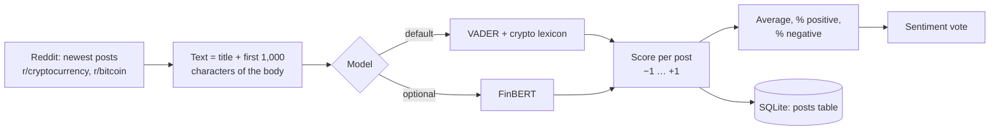

# Sentiment

Coin Buddy measures the mood of crypto Reddit and turns it into a score from −1 (very negative) to +1 (very positive). The code is in `coin_buddy/data/sentiment.py`.



## 1. Fetching posts

| Source | Used when | Notes |
|---|---|---|
| **Public JSON feed** (`reddit.com/r/<sub>/new.json`) | Default, no setup | Works without credentials. Rate-limited, so the dashboard caches sentiment for 5 minutes. |
| **praw** (official API) | `REDDIT_CLIENT_ID` and `REDDIT_CLIENT_SECRET` are set in `.env` | Higher limits. Needs `pip install -e ".[reddit]"`. |

By default it reads the 25 newest posts from each of r/cryptocurrency and r/bitcoin, so 50 posts. If one subreddit fails, the others are still used. If all fail, sentiment reports "no data" and [abstains](signals.md).

## 2. Scoring each post

### VADER (default)

[VADER](https://github.com/cjhutto/vaderSentiment) is a rule-based model built for social media. It understands capitals ("GREAT"), punctuation ("great!!!"), emoji, negation ("not good") and intensifiers ("very good"), and it runs instantly on any computer.

Its **compound** score, from −1 to +1, is the post's sentiment.

VADER doesn't know crypto slang, so Coin Buddy adds 36 words to its lexicon on VADER's own −4…+4 scale:

| Bullish | Score | | Bearish | Score |
|---|---|---|---|---|
| mooning | +2.8 | | rugpull | −3.5 |
| moon, bullish | +2.5 | | hacked | −3.2 |
| ath (all-time high) | +2.2 | | rekt, scam, rug, crash, hack | −3.0 |
| rally, wagmi | +2.0 | | bearish, capitulation, liquidated | −2.5 |
| breakout | +1.8 | | dumping | −2.3 |
| hodl, btfd, bull, adoption | +1.5 | | dump, fud, ngmi, bagholder | −2.0 |
| pump, accumulate | +1.2 | | dip | −0.8 |

So "BTC is going to the moon, very bullish" scores strongly positive and "Got rekt, total rugpull" strongly negative. A test checks both.

### FinBERT (optional)

[FinBERT](https://huggingface.co/ProsusAI/finbert) is a transformer model trained on financial text. It's better at news-style language, but it downloads about 1.5 GB (PyTorch and model weights) and is slower. Enable it with:

```bash
pip install -e ".[finbert]"
```

```yaml
sentiment:
  model: finbert
```

Its score is \(P(\text{positive}) - P(\text{negative})\), on the same −1…+1 scale as VADER, so everything else works unchanged.

## 3. Aggregating

| Output | Definition |
|---|---|
| `score` | Mean of all post scores. Used for the vote. |
| `n_posts` | Number of posts scored. |
| `positive_share` | Fraction of posts scoring above +0.05. |
| `negative_share` | Fraction of posts scoring below −0.05. |

The ±0.05 neutral zone is VADER's standard convention.

## 4. Storing

Every scored post is saved in the `posts` table with its Reddit id, so a post fetched twice is stored once. `Store.sentiment_history("1h")` turns that into an hourly sentiment series for backtesting. See [Data & storage](../architecture/storage.md).

## Limitations

- **Reddit is not the market.** Posts often react to price moves rather than predict them.
- **Small sample.** 50 posts is a snapshot of the mood, not a measurement.
- **Sarcasm** ("great, another 20% dump") fools both models.
- **Not market-specific.** The subreddits are general crypto, so the same sentiment feeds every coin's signal.

These are good starting points for extending the project: see [Extending Coin Buddy](../development/extending.md).
