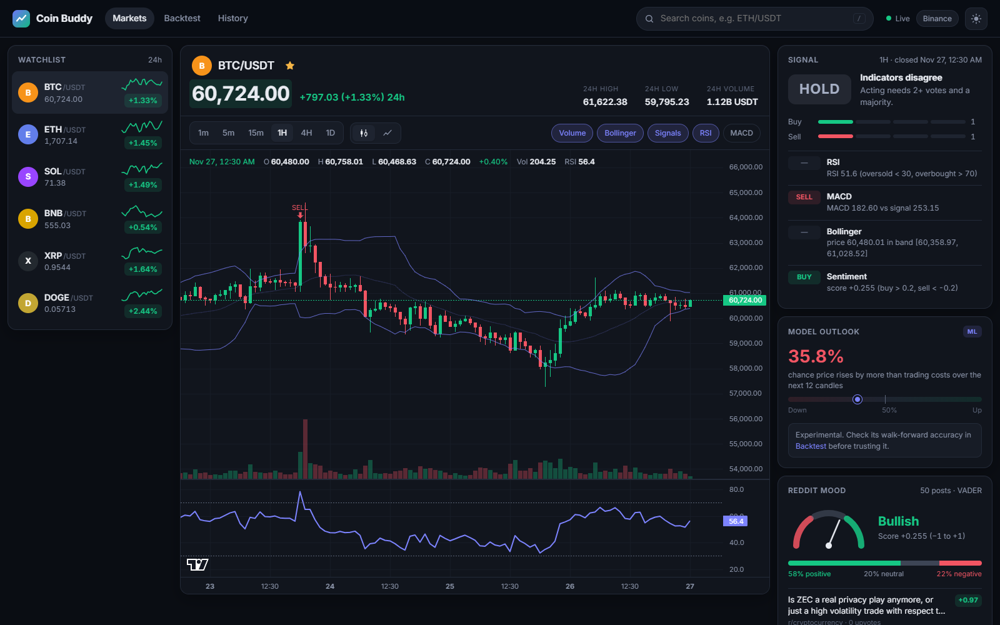

---
hide:
  - navigation
---

# Coin Buddy

Crypto market signals from technical indicators and Reddit sentiment, plus an honest backtester that shows whether they actually work. No API keys and no paid services. Every dependency is free and open-source.

{ .shot }

!!! warning "Educational project"
    Coin Buddy is a learning tool. Its signals are **not financial advice**, and it **never places trades**.

## What it does

-   :material-chart-candlestick:{ .lg .middle } **Live market dashboard**

    ---

    A trading-style web app: watchlist with sparklines, interactive candlestick charts with volume,
    Bollinger Bands, RSI and MACD, and live prices that flash on every change.

    [:octicons-arrow-right-24: Markets dashboard](user-guide/dashboard.md)

-   :material-vote:{ .lg .middle } **Explainable signals**

    ---

    RSI, MACD, Bollinger Bands and Reddit sentiment each cast a vote. Every BUY, SELL or HOLD
    shows which indicators voted and why.

    [:octicons-arrow-right-24: Signal engine](concepts/signals.md)

-   :material-scale-balance:{ .lg .middle } **Honest backtesting**

    ---

    Replays real history with fees, slippage and no lookahead, and always compares against
    simply holding the coin.

    [:octicons-arrow-right-24: Backtesting](concepts/backtesting.md)

-   :material-brain:{ .lg .middle } **ML on real outcomes**

    ---

    A gradient-boosting model trained on real price history, evaluated walk-forward against
    a naive baseline.

    [:octicons-arrow-right-24: Machine learning](concepts/machine-learning.md)

## The key finding

Backtested on two years of hourly BTC/USDT candles (Nov 2024 – Nov 2026), with 0.10% fee and 0.05% slippage per side:

| Strategy | Before costs | After costs | Buy & hold | Trades |
|---|---|---|---|---|
| Rule engine (RSI + MACD + Bollinger) | −23.2% | **−37.0%** | −34.3% | 66 |
| ML model (walk-forward, out of sample) | **+20.6%** | **−82.4%** | −37.1% | 640 |

Classic indicators carry no edge after costs. The ML model found real short-term patterns, but it traded so often that fees consumed everything it earned. Learning to measure this honestly is the point of the project. The [Backtesting](concepts/backtesting.md) and [Machine learning](concepts/machine-learning.md) pages explain why.

## Where to start

| If you want to… | Read |
|---|---|
| Install it and see it working in 5 minutes | [Installation](getting-started/installation.md), then the [Quickstart tour](getting-started/quickstart.md) |
| Understand every part of the dashboard | [Markets dashboard](user-guide/dashboard.md), [Backtest page](user-guide/backtest-page.md) |
| Understand the maths behind a signal | [How it works](concepts/indicators.md) |
| Understand how the code fits together | [Architecture overview](architecture/overview.md) |
| Change or extend it | [Extending Coin Buddy](development/extending.md) |
| Explain the design in an interview | [Design decisions](DESIGN.md) |

## Built with

All free and open-source: [ccxt](https://github.com/ccxt/ccxt) for exchange data · [pandas](https://pandas.pydata.org/) · [scikit-learn](https://scikit-learn.org/) · [VADER](https://github.com/cjhutto/vaderSentiment) · [FastAPI](https://fastapi.tiangolo.com/) · [TradingView Lightweight Charts](https://github.com/tradingview/lightweight-charts) · SQLite · [pytest](https://pytest.org/) · [ruff](https://docs.astral.sh/ruff/) · [MkDocs Material](https://squidfunk.github.io/mkdocs-material/) for these docs.
