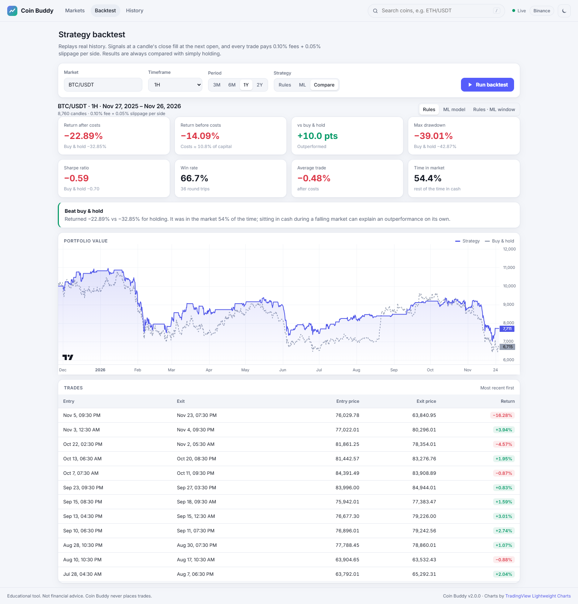
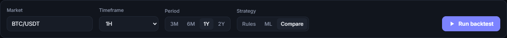
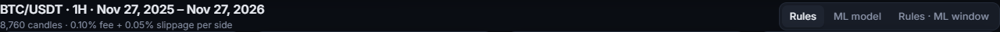
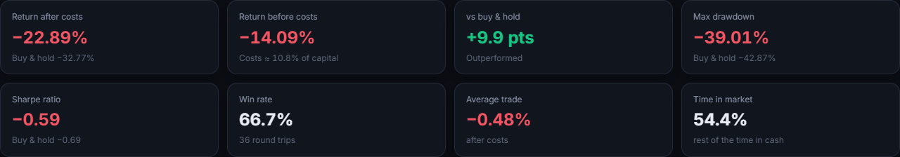
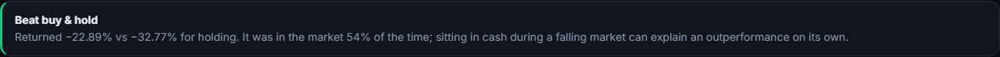
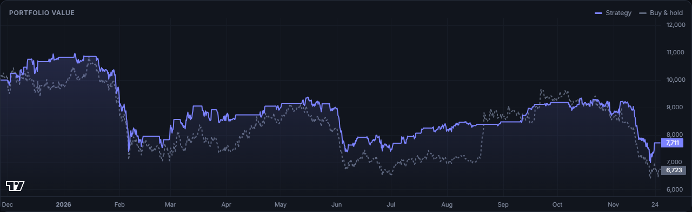
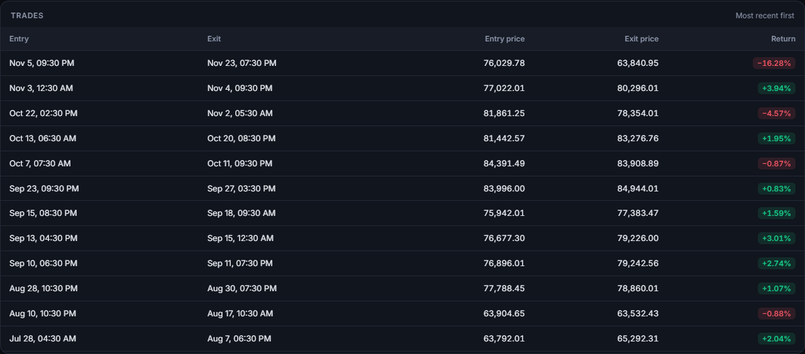

# Backtest page

The Backtest page answers one question: **would this strategy have made money, after costs, compared with just holding the coin?** Open it from the top bar, or go to `#/backtest`.

{ .shot }

## Running a backtest

{ .shot }

| Field | Options | Notes |
|---|---|---|
| **Market** | Any spot market on the exchange | Pre-filled with the market you were viewing. Type `eth` and it resolves to `ETH/USDT`. |
| **Timeframe** | 5m · 15m · 1H · 4H · 1D | 1m isn't offered because a year of 1-minute candles is over 500,000 rows. |
| **Period** | 3M · 6M · 1Y · 2Y | How much history to replay. |
| **Strategy** | Rules · ML · Compare | **Compare** runs both and adds a fair side-by-side (see below). |

Click **Run backtest**. A progress bar shows while history downloads and, for ML, while the model trains walk-forward. That can take up to a minute. Results are cached for an hour, so running the same backtest again is instant.

## Reading the results

### Result tabs

{ .shot }

The title shows the market, timeframe and exact date range, the number of candles, and the costs charged. With **Compare**, three tabs appear:

| Tab | What it is |
|---|---|
| **Rules** | The voting engine over the **whole** period. |
| **ML model** | The machine-learning strategy, only over the period where it was tested out of sample. It can't trade during its first training window. |
| **Rules · ML window** | The rules again, but over **the same window as ML**. Compare this tab with ML for a fair contest. |

### KPI tiles

{ .shot }

| Tile | Definition | How to read it |
|---|---|---|
| **Return after costs** | Total return including every fee and slippage charge. Sub-line: buy-and-hold over the same period. | The headline number. |
| **Return before costs** | The same trades with zero costs. Sub-line: total costs as a share of capital. | A big gap between before and after means the strategy trades too often. |
| **vs buy & hold** | After-cost return minus buy-and-hold return, in percentage points. | Positive means the strategy beat holding. |
| **Max drawdown** | The worst fall from a peak to a later low. | How painful it would have felt. Compare it with buy-and-hold's. |
| **Sharpe ratio** | Average return ÷ volatility, annualised. | Return per unit of risk. Above 1 is good, below 0 means it lost money. |
| **Win rate** | Share of round trips (buy then sell) that made money after costs. | A high win rate can still lose money if losers are bigger than winners. |
| **Average trade** | Mean after-cost return per round trip. | Must comfortably exceed costs (0.3% per round trip by default). |
| **Time in market** | Share of candles spent holding the coin. | A strategy in cash during a crash "beats" holding without any skill. |

Exact formulas are on the [Backtesting](../concepts/backtesting.md#metrics) page.

### Takeaway

{ .shot }

A one-paragraph conclusion, written automatically from the numbers:

| Situation | Headline |
|---|---|
| Profitable before costs, losing after | **A real edge, eaten by costs**: the strategy found something, but it trades too much. |
| Beat buy-and-hold after costs | **Beat buy & hold**: with a reminder to check time in market. |
| Neither | **No edge after costs.** |

On the **ML model** tab it also reports out-of-sample accuracy against the naive baseline.

### Portfolio value

{ .shot }

The value of a $10,000 portfolio over time: the strategy (solid, shaded) against buy-and-hold (dashed). Flat stretches are periods in cash. Hover to read exact values.

### Trades

{ .shot }

Every round trip, most recent first (up to 300): when it entered and exited, the fill prices, and the after-cost return.

!!! info "Fill prices are next-candle opens"
    A signal is known only once a candle **closes**, so the trade fills at the **next** candle's open. That's why entry prices don't match the close of the candle where the arrow appears.

## Same thing from the terminal

```bash
coin-buddy backtest --symbol BTC/USDT --timeframe 1h --days 365 --strategy both --report
```

`--report` writes an interactive HTML report to `reports/backtest.html`. See [Command line](cli.md#backtest).
