# Markets dashboard

The Markets screen is Coin Buddy's home. Start it with:

```bash
coin-buddy dashboard --open          # http://127.0.0.1:8000
```

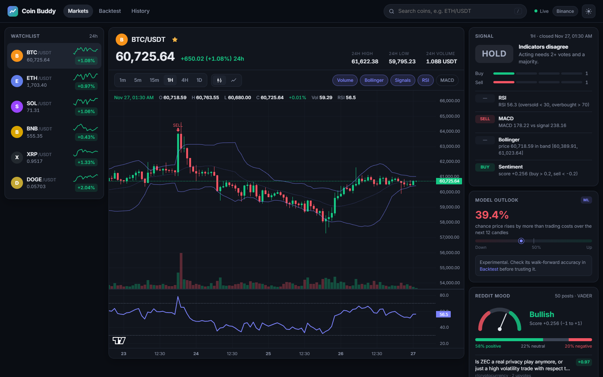{ .shot }

The screen is made of six parts, each explained below:

1. **Top bar** (across the top): navigation, search, live status, theme.
2. **Watchlist** (left column).
3. **Quote header** (top of the middle column): price and 24h stats.
4. **Chart toolbar**: timeframe, chart type, indicator toggles.
5. **Chart**: price, volume, indicators and signal markers.
6. **Insight cards** (right column): Signal, Model outlook, Reddit mood.

---

## ① Top bar

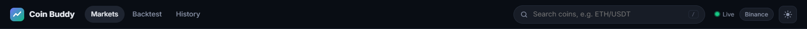{ .shot }

| Element | What it does |
|---|---|
| **Coin Buddy** logo | Returns to the Markets screen. |
| **Markets · Backtest · History** | The three screens. The address bar shows which one is open (`#/markets`, `#/backtest`, `#/history`). |
| **Search** | Type a coin and press ++enter++. `sol` finds `SOL/USDT`; full symbols like `ETH/BTC` work too. Suggestions come from every spot market on the exchange. Press ++slash++ anywhere to jump to it, and ++escape++ to leave it. |
| **Status pill** | Data freshness (see below). |
| **Exchange pill** | The data source, set by `market.exchange` in the config. |
| **☀ / ☾** | Switches between dark and light themes. Your choice is remembered in this browser. |

### Live status

| Status | Meaning |
|---|---|
| :material-circle:{ style="color:#16c784" } **Live** | The last successful update arrived within 3× the refresh interval (30 s by default). |
| :material-circle:{ style="color:#f5b546" } **Delayed** | No successful update for 30–90 seconds. Usually a slow exchange response. |
| :material-circle:{ style="color:#f25563" } **Offline** | Nothing for 90 seconds or more. Check your connection, or whether the server stopped. |
| :material-circle:{ style="color:#f5b546" } **Paused** | The browser tab is hidden. Polling stops to save requests, and resumes instantly when you return. |
| **Connecting** | The page just loaded and the first response hasn't arrived yet. |

---

## ② Watchlist

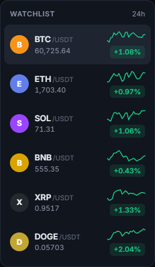{ .shot width="300" }

Each row shows:

- **Coin badge and name:** the base currency (BTC), then the quote currency (/USDT).
- **Last price.**
- **24-hour sparkline:** the last 24 hourly closes. Green if the price is higher than 24 hours ago, red if lower. Refreshed every 5 minutes.
- **24h change:** the percentage move over the last 24 hours, as reported by the exchange.

Click a row to open that market. The highlighted row is the one on screen.

**Adding and removing coins:** click the ☆ next to the market name in the quote header. Your watchlist is saved in **this browser only**, so another visitor or another browser sees the default list from `web.watchlist` in the config.

On narrow screens the watchlist becomes a horizontal strip you can swipe.

---

## ③ Quote header

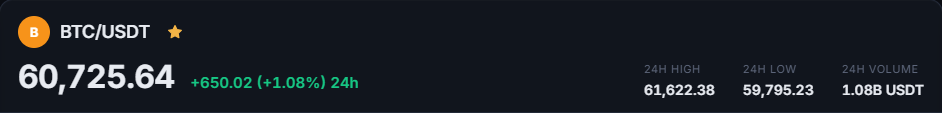{ .shot }

| Element | Meaning |
|---|---|
| Large price | The latest traded price, updated every 10 seconds. It **flashes green** when the price ticks up and **red** when it ticks down. |
| Change line | Absolute and percentage change over the last 24 hours. |
| 24h high / low | The highest and lowest trade in the last 24 hours. |
| 24h volume | Value traded in the last 24 hours, in the quote currency (USDT here). |
| ☆ / ★ | Add to or remove from your watchlist. |

---

## ④ Chart toolbar

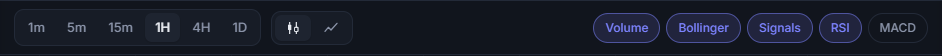{ .shot }

| Control | Options | Notes |
|---|---|---|
| **Timeframe** | 1m · 5m · 15m · 1H · 4H · 1D | The size of each candle. Changing it reloads the chart **and** recomputes the signal for that timeframe. |
| **Chart type** | Candlesticks · Line | Line mode draws closing prices as a shaded area, green if the visible period rose and red if it fell. |
| **Volume** | on/off | Volume bars along the bottom of the price pane. |
| **Bollinger** | on/off | Upper, middle (dotted) and lower bands. |
| **Signals** | on/off | BUY/SELL arrows on the price. |
| **RSI** | on/off | RSI pane under the price, with dashed lines at 70 and 30. |
| **MACD** | on/off | MACD pane: histogram, MACD line (indigo) and signal line (amber). |

Your choices are remembered in this browser.

---

## ⑤ Chart

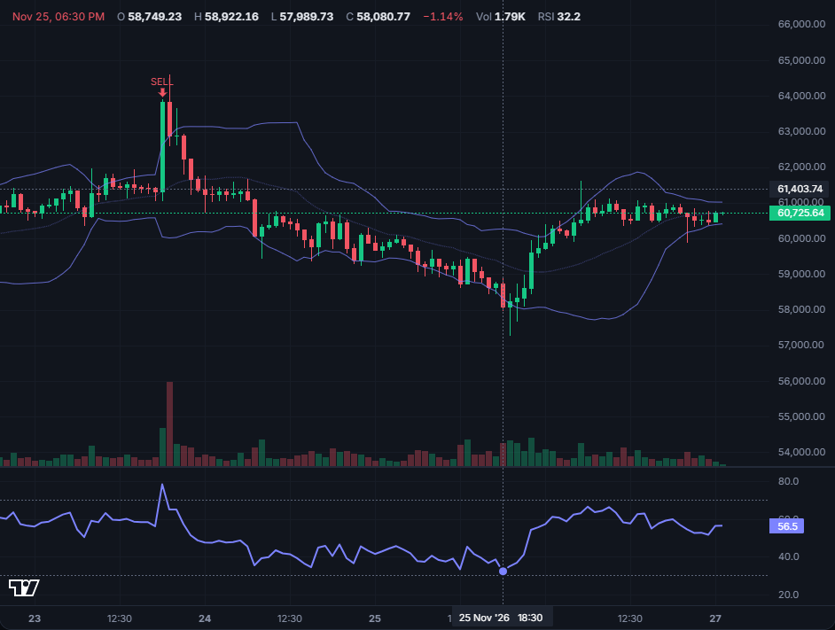{ .shot }

The chart uses TradingView's open-source Lightweight Charts, so it behaves like charts on exchange sites:

| Action | Mouse / trackpad | Touch |
|---|---|---|
| Scroll back in time | Drag left/right | Swipe |
| Zoom | Mouse wheel / pinch | Pinch |
| Zoom the price axis | Drag the price scale up/down | — |
| Reset zoom | Double-click the time axis | — |
| Resize panes | Drag the line between panes | — |

**Reading a candle.** Each candle covers one timeframe period. Green means it closed above where it opened; red means it closed below. The body spans open to close, and the thin wicks reach the period's high and low.

**The legend** (top-left) shows the candle under your cursor: time, **O**pen, **H**igh, **L**ow, **C**lose, percentage change, volume and RSI. When the cursor isn't on the chart, it shows the latest candle.

**The latest candle is live.** It keeps updating until its period ends. Signals only use **closed** candles, because a forming candle's indicators keep changing.

**BUY/SELL arrows** mark where the rule strategy would **enter** (BUY ▲, below the bar) or **exit** (SELL ▼, above the bar) a position. These are the exact trades the [backtester](../concepts/backtesting.md) simulates, not every candle where a BUY vote existed.

**Times** are shown in your computer's local time zone.

??? example "Line mode with MACD"
    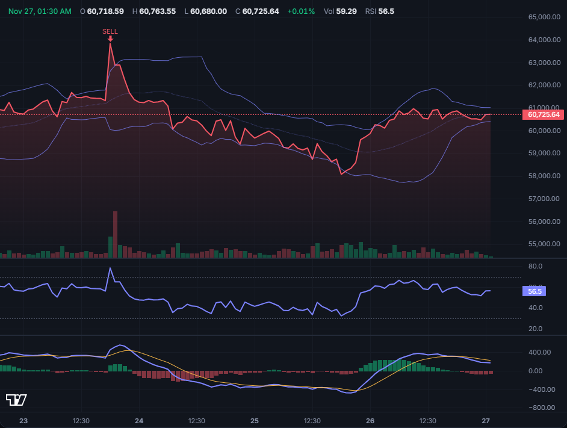{ .shot }

---

## ⑥ Insight cards

### Signal

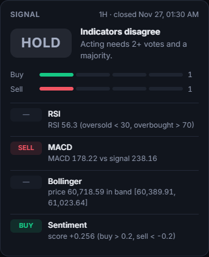{ .shot width="360" }

- **The verdict** (<span class="tag-buy">BUY</span> <span class="tag-sell">SELL</span> <span class="tag-hold">HOLD</span>) for the last **closed** candle of the selected timeframe. The header says when that candle closed.
- **The headline** summarises the vote: "2 of 4 indicators point up", "Indicators disagree", or "No clear edge".
- **Buy and sell meters** show how many of the four indicators voted each way.
- **The vote list** shows each indicator's vote and the actual numbers behind it, for example `RSI 56.3 (oversold < 30, overbought > 70)`. A dash means the indicator abstained.

The rule: a side needs **at least 2 votes and more votes than the other side**. Ties are always HOLD. [Full explanation →](../concepts/signals.md)

The signal refreshes every 60 seconds.

### Model outlook

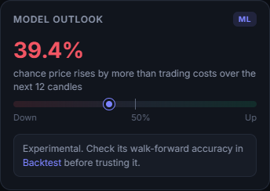{ .shot width="360" }

The ML model's estimated probability that price will rise **by more than trading costs** over the next 12 candles. The marker sits left of 50% when the model leans down and right when it leans up.

If no model exists for the market and timeframe on screen, the card shows the exact command to train one, for example `coin-buddy train --symbol ETH/USDT --timeframe 4h`. Each model only predicts for the market it was trained on. [Why →](../concepts/machine-learning.md#one-model-per-market)

!!! warning
    This is an experiment, not a forecast. Check its out-of-sample accuracy on the [Backtest page](backtest-page.md) before trusting it.

### Reddit mood

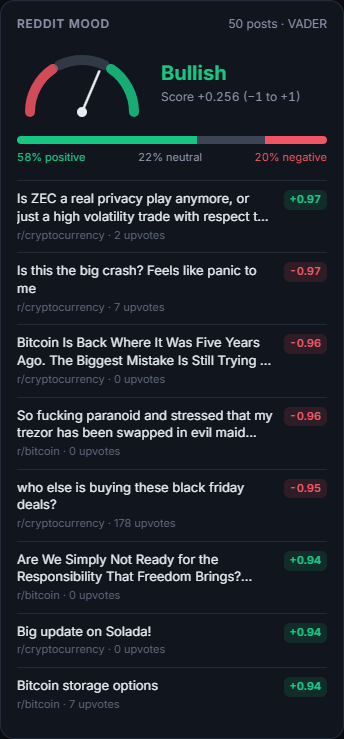{ .shot width="360" }

| Part | Meaning |
|---|---|
| Gauge and label | The average sentiment of recent posts, from −1 (very negative) to +1 (very positive). Labels: **Bullish** above +0.2, **Bearish** below −0.2, **Leaning bullish/bearish** beyond ±0.05, otherwise **Neutral**. |
| Score | The exact average. This is what the Sentiment vote uses. |
| Coloured bar | Share of posts that are positive (> +0.05), neutral, and negative (< −0.05). |
| Post list | The 8 posts with the strongest sentiment either way, with their score. Click one to open it on Reddit. |
| Header | Number of posts scored and the model used (VADER or FinBERT). |

Sentiment is shared across all markets (it reads general crypto subreddits) and refreshes every 5 minutes. If Reddit can't be reached, the card says so and sentiment abstains from the vote. [How sentiment is scored →](../concepts/sentiment.md)

---

## Sharing a view

The address bar always holds the current market and timeframe, for example:

```text
http://127.0.0.1:8000/?symbol=ETH/USDT&tf=4h#/markets
```

Bookmark it or send it, and it opens the same view.

## Mobile

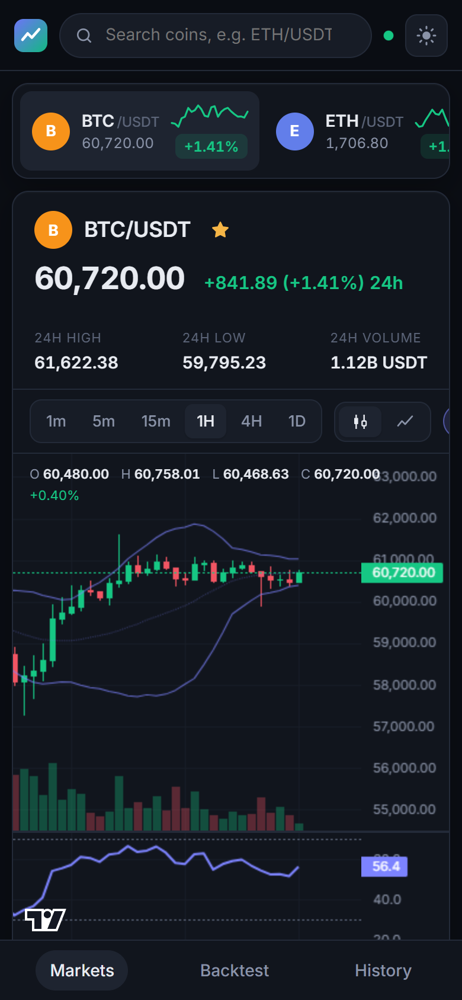{ .shot width="320" }

On phones, the navigation moves to a bar at the bottom, the watchlist becomes a swipeable strip, the insight cards stack under the chart, and the chart legend shows only open/high/low/close.

## What's remembered, and where

All preferences live in **your browser's local storage**. Nothing is sent to a server, and clearing site data resets them.

| Preference | Storage key |
|---|---|
| Theme | `cb-theme` |
| Last market / timeframe | `cb-symbol`, `cb-tf` |
| Chart type | `cb-chart-type` |
| Indicator toggles | `cb-indicators` |
| Watchlist | `cb-watchlist` |

Signals themselves are saved on the server, in SQLite: see [History](history.md).
