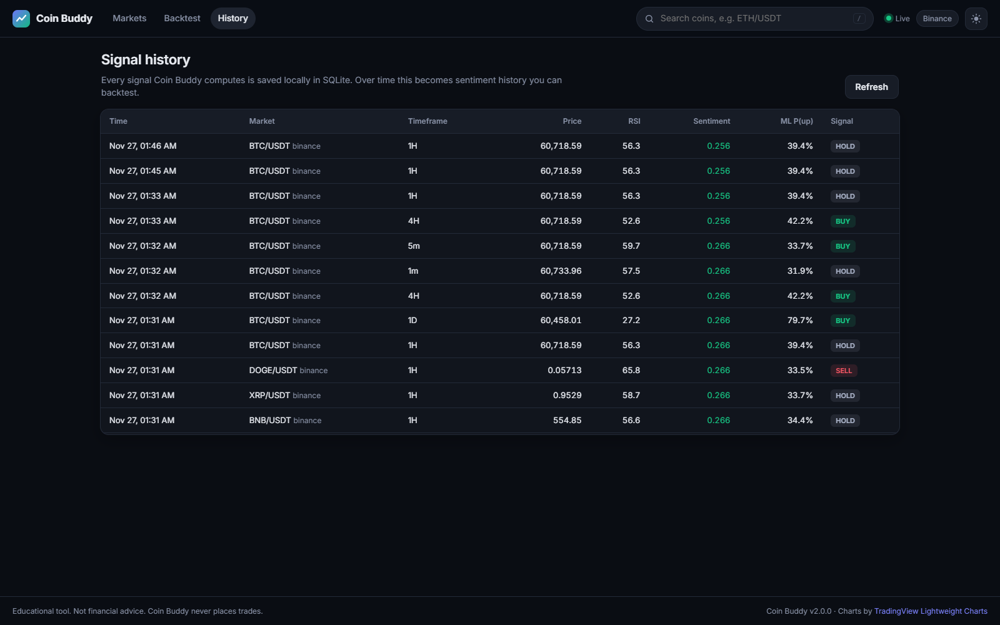

# History page

Every signal Coin Buddy computes, in the dashboard or with `coin-buddy watch` and `coin-buddy snapshot`, is saved to a local SQLite database. The History page shows the latest 300.

{ .shot }

| Column | Meaning |
|---|---|
| **Time** | When the signal was computed, in your local time. |
| **Market** | Symbol, plus the exchange in grey. |
| **Timeframe** | Candle size the signal used. |
| **Price** | Close of the last closed candle. |
| **RSI** | RSI at that candle. |
| **Sentiment** | Average Reddit sentiment used in the vote. A dash means Reddit was unreachable. |
| **ML P(up)** | The model's probability, if a model exists for that market and timeframe. |
| **Signal** | BUY, SELL or HOLD. |

Click **Refresh** to reload.

## How often rows are added

The dashboard recomputes the signal at most **once a minute per market and timeframe**, however many tabs are open. `coin-buddy watch` adds one row per check (every 5 minutes by default).

## Why keep history?

Historical Reddit sentiment isn't available for free, so the rule backtester can't include the sentiment vote yet. Every saved post builds that history. After a few weeks of `coin-buddy watch`, you can backtest sentiment too: see [Extending Coin Buddy](../development/extending.md#backtest-with-your-sentiment-history).

The database lives at `data/coin_buddy.db` (configurable). Its schema is documented in [Data & storage](../architecture/storage.md). Delete the file to start fresh.
